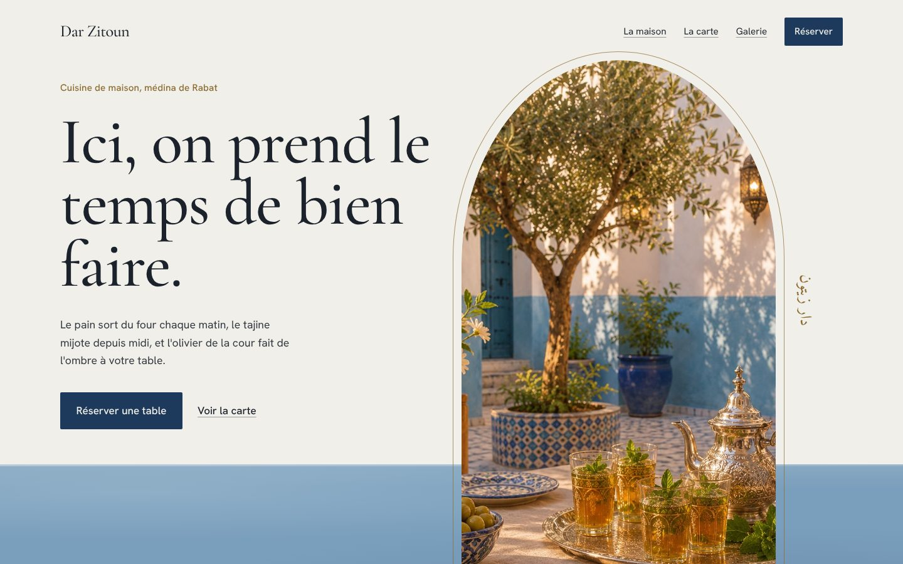
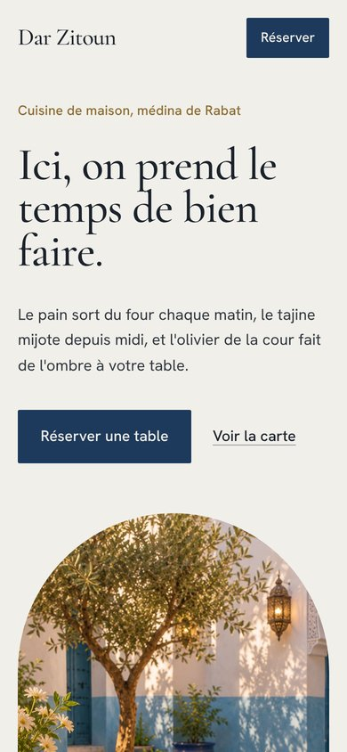

# Dar Zitoun

**A one-page website for a fictional Moroccan home-cooking restaurant in Rabat.** Built as a design and front-end portfolio piece with Astro and Tailwind CSS, and developed with AI-assisted tooling (Claude Code).

**Live site:** [dar-zitoun-chi.vercel.app](https://dar-zitoun-chi.vercel.app/)



> Dar Zitoun is a concept, not a real business. The address, phone number and reviews are placeholders, and the site says so in its footer and reviews section.

## What it shows

- **A design brief turned into a site.** I wrote a full brief first ([BRIEF.md](BRIEF.md)): palette, type scale, layout per section, motion rules and a list of banned "template" patterns. All French copy lives in [CONTENU.md](CONTENU.md), and the site uses it word for word.
- **A distinct visual identity.** The accent is Rabat blue, taken from the walls of the Kasbah des Oudayas, rather than the usual terracotta. The signature element is a Moroccan arch: key images are cropped inside it and stand on a painted blue wall band in the hero.
- **Editorial menu, not cards.** Dishes are set as a typeset list with dotted price leaders. On desktop, a small arched photo of the dish follows the cursor.
- **A working reservation form** connected to [Web3Forms](https://web3forms.com), with the key kept in an environment variable.
- **Performance and accessibility basics:** self-hosted fonts (no Google Fonts request), semantic HTML, French alt text, visible focus states, keyboard navigation, and all motion turned off under `prefers-reduced-motion`.

<p align="center"></p>

## Tech stack

| Area | Choice |
|---|---|
| Framework | [Astro 5](https://astro.build), static output |
| Styling | Tailwind CSS 4 (Vite plugin) plus CSS custom properties for the palette |
| Fonts | Cormorant Garamond, Hanken Grotesk and Amiri (Arabic), self-hosted via Fontsource |
| Form | Web3Forms |
| Hosting | Vercel |
| Images | AI-generated with one shared photographic style prompt (prompts in [BRIEF.md](BRIEF.md)) |

## Project structure

```
src/
  pages/index.astro      the whole one-page site, section by section
  layouts/Base.astro     <head>, SEO and Open Graph meta, fonts
  components/Img.astro   image with a named placeholder until the file exists
  styles/global.css      palette tokens, type scale, arch masks, motion
public/
  images/                dish, interior and gallery photos
  favicon.svg            arch outline
BRIEF.md                 design brief
CONTENU.md               all site copy (French)
```

## Run it locally

```bash
npm install
npm run dev        # http://localhost:4321
npm run build      # static site in dist/
```

To make the reservation form send emails, get a free key at [web3forms.com](https://web3forms.com), copy `.env.example` to `.env` and set `PUBLIC_WEB3FORMS_KEY`. On Vercel, add the same variable under Project Settings → Environment Variables.

## Design decisions

- **Blue instead of terracotta:** cream, serif and terracotta is the most common look of AI-generated restaurant sites. The blue-and-white walls are specific to Rabat.
- **No section numbers or uppercase labels:** the sections aren't a sequence, and those details read as template.
- **Motion kept to three things:** arch reveals on scroll, the menu hover image, and link and button transitions.

## Author

**Omar Abidi**, Informatics Engineering (AI) student at Telkom University · [GitHub](https://github.com/omar-abidi-dev) · [LinkedIn](https://www.linkedin.com/in/omar-abidi)
